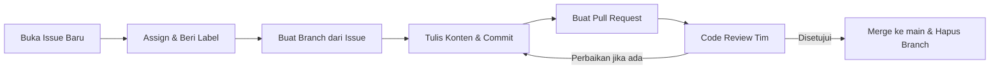

# Panduan Kontribusi Tim (CONTRIBUTING)

Selamat datang di repositori **Kumpulan Tips Belajar Kolaboratif**. Untuk menjaga kerapian, keterlacakan riwayat (*traceability*), dan keselarasan antar anggota tim, seluruh kontributor diwajibkan mengikuti alur kerja berikut.

---

## 📋 1. Alur Kerja (Workflow)



---

## 🌿 2. Aturan Branching

1. Jangan pernah melakukan commit langsung ke branch `main`.
2. Buat branch baru yang terasosiasi langsung dengan nomor Issue yang sedang dikerjakan.
3. Format penamaan branch:
   - `<nomor-issue>-<kata-kunci-singkat>`
   - Contoh: `1-tambah-tips-mengatur-jadwal-belajar`, `2-tambah-tips-fokus`

---

## 📝 3. Format Pesan Commit

Gunakan format commit yang jelas dan deskriptif:
```text
<tipe>(<lingkup>): <deskripsi singkat perubahan>

Contoh:
feat(jadwal): tambah berkas tips-jadwal.md dengan 4 tips manajemen waktu
docs(readme): perbarui tautan panduan belajar
```

---

## 🔀 4. Pengajuan Pull Request (PR)

1. Pastikan judul PR singkat dan merepresentasikan perubahan yang dibuat.
2. Tulis deskripsi PR dengan menyertakan kata kunci otomatis penutup issue:
   ```markdown
   Menambahkan tips mengatur jadwal belajar.
   
   Closes #1
   ```
   *(Ganti `#1` sesuai nomor issue yang ditangani)*.
3. Tetapkan setidaknya satu rekan tim pada bagian **Reviewers**.

---

## 🔍 5. Standar Code Review

Setiap anggota yang ditugaskan sebagai peninjau (*reviewer*) wajib:
1. Membuka tab **Files changed** pada Pull Request.
2. Meninjau baris demi baris dan memberikan **minimal dua komentar**.
3. Setidaknya satu komentar berupa saran perbaikan/masukan konstruktif dengan format:
   ```text
   Saran: [isi saran perbaikan] agar [alasan/manfaat yang dicapai]
   ```
   *Contoh:*
   `Saran: tambahkan estimasi waktu istirahat pada teknik Pomodoro agar pembaca pemula tidak merasa kelelahan saat mencobanya.`
4. Memilih tindakan review:
   - **Approve**: jika konten sudah sesuai dan layak digabungkan.
   - **Request changes**: jika terdapat kesalahan mendasar atau kekurangan konten wajib.

---

## 🚀 6. Penggabungan (Merge) & Pembersihan

Setelah PR disetujui:
1. Lakukan penggabungan (*Merge pull request*) ke branch `main`.
2. Klik tombol **Delete branch** untuk menjaga repositori tetap bersih dan rapi.
3. Verifikasi pada tab **Issues** bahwa issue terkait telah otomatis ditutup (*Closed*).
